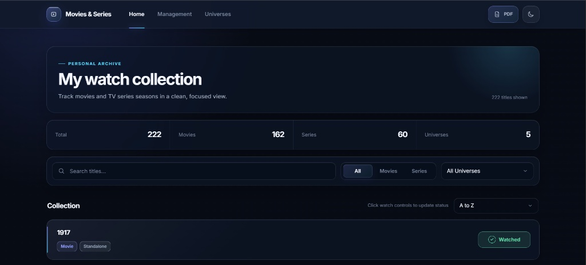
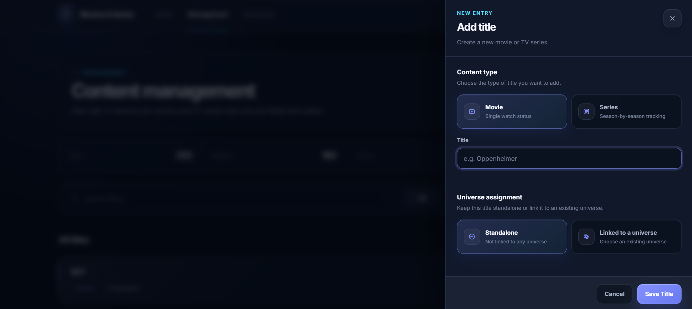
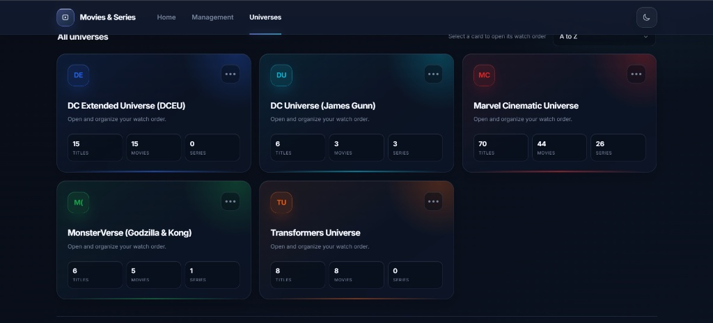
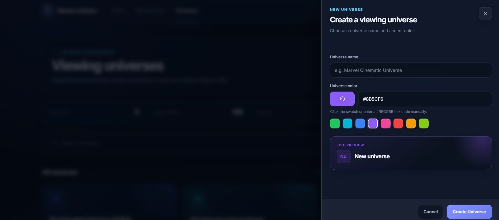

# Movies & Series

A clean, responsive ASP.NET Core MVC (.NET 10) web application for tracking personal movies, TV series seasons, and interconnected viewing universes, with one-click PDF archive export.

## Features

- **Watchlist Dashboard (`Home`)**: Browse your full collection with instant prefix search, content type filters (Movies / Series), universe filtering, and A–Z, Newest, or Universe Order sorting. Toggle movie watch status or individual TV series seasons in real time.
- **Content Management (`Management`)**: Add, edit, and delete movies and series (1–25 seasons) through a slide-over drawer. Assign items to a viewing universe at any exact position while automatically shifting subsequent items.
- **Viewing Universes (`Universes`)**: Create custom color-coded universes with live preview, inspect each universe's watch order, drag-and-drop to reorder items, move items to specific positions, or detach items back to standalone.
- **PDF Export**: Generate a formatted A4 watch archive PDF (powered by QuestPDF) grouped by universes, standalone movies, and standalone series.
- **Responsive & Theme-Aware**: Supports dark and light themes (persisted in `localStorage`) and adapts cleanly across desktop, tablet, and mobile viewports.

## Screenshots

### Watchlist Dashboard


### Add & Manage Titles


### Viewing Universes


### Create Viewing Universe


## Tech Stack

- **Framework**: ASP.NET Core MVC (.NET 10)
- **ORM & Database**: Entity Framework Core 10 + SQL Server
- **PDF Generation**: QuestPDF (Community License)
- **Frontend**: Razor Views, vanilla JavaScript, modular CSS with custom properties

## Getting Started

### Prerequisites

- [.NET 10 SDK](https://dotnet.microsoft.com/download)
- SQL Server / SQL Server Express / LocalDB

### Configuration

1. Clone the repository:
   ```bash
   git clone <your-repository-url>
   cd MoviesAndSeries
   ```

2. Configure your database connection string. Do **not** commit real credentials or private server details to GitHub. You can either use .NET User Secrets (recommended):
   ```bash
   cd MoviesAndSeries
   dotnet user-secrets init
   dotnet user-secrets set "ConnectionStrings:DefaultConnection" "Server=.\SQLEXPRESS;Database=MoviesAndSeriesDb;Trusted_Connection=True;TrustServerCertificate=True;MultipleActiveResultSets=True"
   ```
   Or update `ConnectionStrings:DefaultConnection` in `MoviesAndSeries/appsettings.json` locally before running (and revert the placeholder before pushing).

3. Apply Entity Framework Core migrations:
   ```bash
   dotnet ef database update
   ```
   *(Or run `Update-Database` in Visual Studio's Package Manager Console.)*

4. Run the application:
   ```bash
   dotnet run
   ```

## Security Practices

- Anti-forgery token validation (`[ValidateAntiForgeryToken]`) on all state-changing `POST` endpoints with `HttpOnly` and `SameSite=Strict` cookie policy.
- Parameterized database access via Entity Framework Core LINQ (no raw SQL interpolation).
- Dedicated request ViewModels to prevent overposting.
- Strict server-side and client-side hex color validation (`#RRGGBB`) and output encoding to prevent XSS and CSS injection.
- HTTP security headers (`Content-Security-Policy`, `X-Content-Type-Options`, `X-Frame-Options`, `Referrer-Policy`, `Permissions-Policy`).
